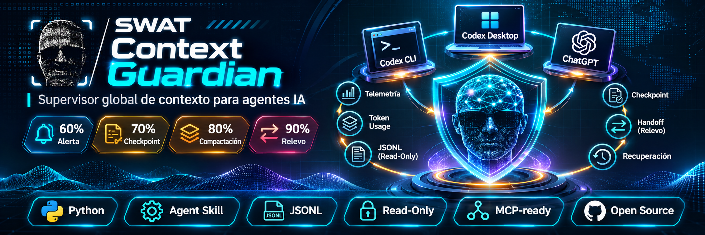
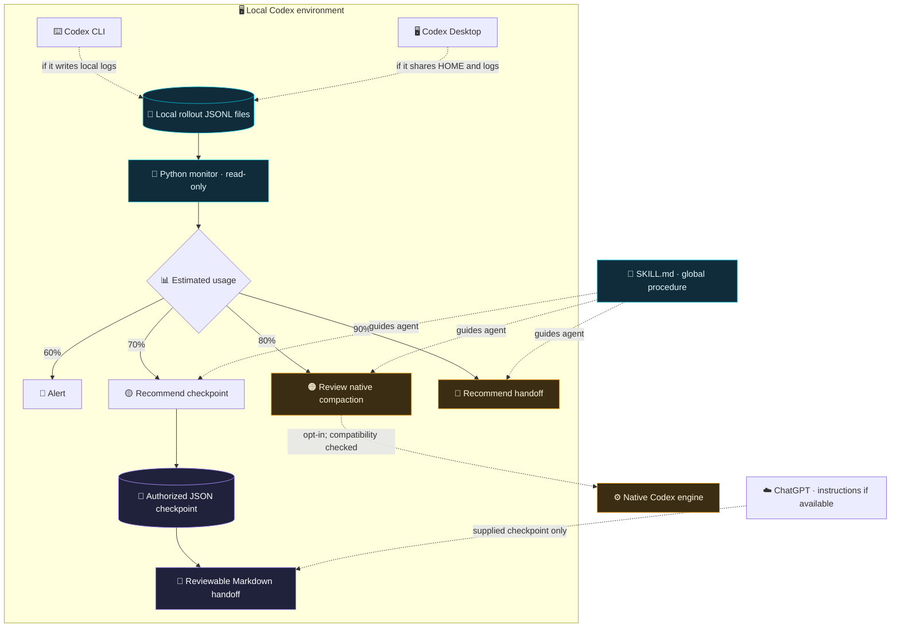

<div align="right">

🌐 **Language:** [🇪🇸 Español](README.md) · **🇬🇧 English** · [🇵🇹 Português](README.pt.md)

</div>

<div align="center">
  

  # 🛡️ SWAT Context Guardian

  **Global skill + local context monitor for Codex.**  
  *Approximate telemetry · Verifiable checkpoints · Safe handoffs across sessions and repositories.*

  [](#project-status)
  [](https://www.python.org/)
  [](docs/INSTALAR_CODEX_CLI.md)
  [](docs/INSTALAR_CODEX_DESKTOP.md)
  [](docs/INSTALAR_CHATGPT.md)

  [](SKILL.md)
  [](docs/ARQUITECTURA.md)
  [](#privacy-and-security)
  [](docs/INSTALAR_CODEX_CLI.md)
  [](docs/INSTALAR_CODEX_CLI.md)
  [](docs/INSTALAR_CODEX_CLI.md)
  [](#requirements)
  [](#roadmap)
  [](#tests)

  **[CLI installation](docs/INSTALAR_CODEX_CLI.md) · [Desktop installation](docs/INSTALAR_CODEX_DESKTOP.md) · [ChatGPT](docs/INSTALAR_CHATGPT.md) · [Architecture](docs/ARQUITECTURA.md)**

  <sub>Detailed linked guides are currently in Spanish; this README contains the main installation and usage instructions in English.</sub>
</div>

---

## ✨ What is it?

**SWAT Context Guardian** addresses a common challenge with development agents: sessions accumulate context, but **decisions, security constraints, verification results and unfinished tasks** must survive context compaction or a move to another conversation.

The project combines **two separate components**:

1. **🧠 Global skill (`SKILL.md`)**. Defines a repeatable process for diagnostics, evidence classification, checkpoints and handoffs. It is installed in `~/.agents/skills/swat-context-guardian/` and can be used across repositories in the same Codex environment.
2. **📡 Python monitor (`scripts/guardian.py`)**. Runs **independently** and reads Codex session JSONL files without modifying the conversation. It reports an **estimate**, not the engine's exact context meter, and raises threshold alerts.

> [!IMPORTANT]
> **A skill is not a daemon.** Installing it does not start the monitor in the background, automatically compact external sessions or give ChatGPT access to your computer's files.

### 🧩 Features and icons

| Icon | Module | Purpose | v0.2 status |
|:---:|---|---|---|
| 🧭 | **Doctor** | Check Codex paths and session availability. | ✅ Implemented |
| 📊 | **Status** | Show estimated context occupancy per session. | ✅ Implemented |
| 📡 | **Watch** | Continuous monitoring through a local process. | ✅ Implemented |
| 🧾 | **Checkpoint** | Create JSON from explicitly supplied information and project metadata. | ✅ Implemented |
| 🔁 | **Handoff** | Generate reviewable continuity Markdown. | ✅ Implemented |
| 🛡️ | **Safety Guard** | Avoid accidental overwrites and preserve configuration backups. | ✅ Basic safeguards |
| 🧠 | **Native Compaction** | Preview optional Codex compaction configuration. | ⚠️ Requires authorization and a compatible version |
| 🔌 | **MCP / App Server** | Monitoring or control through a managed service. | 🗺️ Not implemented |
| ☁️ | **ChatGPT** | Reusable instructions for reviewing supplied checkpoints. | 📄 Separate package; availability-dependent |

## 🚦 Context policy

| Approximate level | Signal | Recommended action | Destructive actions? |
|:---:|---|---|:---:|
| 🔵 **60%** | Early warning | Reduce verbose output; keep monitoring. | No |
| 🟡 **70%** | Checkpoint | Preserve verified decisions and evidence. | No |
| 🟠 **80%** | Compaction | Review the native mechanism **if enabled and compatible**. | No |
| 🔴 **90%** | Handoff | Prepare Markdown and verify continuity in another session. | No |

These thresholds are **monitoring alerts**, not a guarantee that Codex will compact at those exact percentages. When metrics are missing, the tool reports `SIN MEDICIÓN` (no measurement) instead of inventing a value.

## 🏗️ Architecture



**Telemetry inputs:** `last_token_usage.total_tokens` and `model_context_window`, when present in local history. **Telemetry outputs:** estimates and the monitor's own JSONL alerts. **Checkpoint input:** only text/evidence explicitly provided and verified by the operator or agent; transcripts are not extracted automatically.

## 📦 Requirements

- **Python 3.11+**, using only the standard library (`tomllib`, `argparse`, `json`, etc.).
- Codex CLI or Desktop with accessible local sessions **for monitoring**. A manual checkpoint can be created even without telemetry.
- Read permission on `CODEX_HOME/sessions`, plus write permission on `CODEX_HOME/context-guardian` for the monitor's own reports.
- No API keys, web services or mandatory Node.js dependencies.

## 🚀 Quick installation (Windows PowerShell)

1. Download and extract `SWAT-Context-Guardian-v0.2.0.zip`. It should contain a `swat-context-guardian/` directory.
2. Open PowerShell and run:

```powershell
cd "$HOME\Downloads\swat-context-guardian"
python .\scripts\install_global.py                 # Preview: NO changes
python .\scripts\install_global.py --apply          # Global installation, no overwrite
```

3. Verify the monitor:

```powershell
$g = "$HOME\.agents\skills\swat-context-guardian\scripts\guardian.py"
python $g doctor
python $g status
python $g watch --interval 10
```

4. Open a new Codex session, use `/skills` or invoke:

```text
$swat-context-guardian check this session's context occupancy and prepare a safe checkpoint without modifying the project.
```

> [!NOTE]
> If `python` is unavailable but `py` exists, use `py -3.11` or your Python 3.11+ interpreter. `watch` runs **only while its process is alive**; stop it with Ctrl+C.

### 🐧 Linux, macOS and Termux

```bash
cd ~/Downloads/swat-context-guardian
python3 scripts/install_global.py
python3 scripts/install_global.py --apply
python3 ~/.agents/skills/swat-context-guardian/scripts/guardian.py doctor
python3 ~/.agents/skills/swat-context-guardian/scripts/guardian.py status
python3 ~/.agents/skills/swat-context-guardian/scripts/guardian.py watch --interval 10
```

On **Termux**, downloads may be located in `~/storage/downloads/`. Windows, WSL, Termux and remote sessions **do not automatically share logs**.

### 🖥️ Codex Desktop

When Codex Desktop and CLI run as the **same user with the same HOME**, they can share a skill installed in `~/.agents/skills/`. Check the Skills selector and restart the app if necessary. **The monitor must still run in a separate terminal.** For remote sessions or isolated environments, verify the relevant HOME directory and permissions.

➡️ [Detailed Codex Desktop guide (Spanish)](docs/INSTALAR_CODEX_DESKTOP.md)

### ☁️ ChatGPT

**Direct installation depends on your plan and workspace.** The original v0.2 documentation lists eligible ChatGPT **Business, Enterprise, Healthcare and Edu** workspaces. Do not assume that skill installation is available on Plus without checking the current product UI and documentation.

- **If Skills are available:** open `Plugins / Add-ons` → `Skills` → `Create` → `Upload from computer` (labels may differ). Use the **separate** `SWAT-Context-Guardian-ChatGPT-Skill.zip`, designed for continuity guidance **without a local process**.
- **If Skills are unavailable:** create a ChatGPT Project, copy the instructions from [`docs/CHATGPT_PROJECT_INSTRUCTIONS.md`](docs/CHATGPT_PROJECT_INSTRUCTIONS.md), and supply checkpoints whenever you need a handoff.

> [!WARNING]
> Importing a skill does not give ChatGPT access to `~/.codex`. It cannot measure this chat's exact context percentage or control a local Codex engine. Active synchronization would require a separately developed and authorized connector/app or MCP integration.

➡️ [Detailed ChatGPT guide (Spanish)](docs/INSTALAR_CHATGPT.md)

## 🛠️ Guardian CLI usage

The examples below assume you have already installed the global skill.

### 1. Diagnose

```powershell
$g = "$HOME\.agents\skills\swat-context-guardian\scripts\guardian.py"
python $g doctor
python $g status
python $g status --json
```

### 2. Monitor and log events

```powershell
python $g watch --interval 10
```

Alerts: `~/.codex/context-guardian/alerts.jsonl` (or `$CODEX_HOME/context-guardian/alerts.jsonl`). If recent rollout files are missing, the program reports that; it does not simulate metrics.

### 3. Create an explicit checkpoint

```powershell
python $g checkpoint `
  --project "C:\Dev\SWAT\update" `
  --summary "Verified project state" `
  --decisions "Explicitly approved decisions" `
  --evidence "Verified commits, tests and evidence" `
  --pending "Actual open items" `
  --next-step "Next authorized step" `
  --safety "Do not change production or migrations"
```

The command prints `CHECKPOINT=...`. Semantic content is neither guessed nor automatically extracted from the full history: the operator/agent must supply it with supporting evidence.

### 4. Prepare a handoff

```powershell
python $g handoff --checkpoint "ACTUAL_PATH_TO_CHECKPOINT.json"
```

Review the Markdown before sharing it with another chat. Confirm that the **branch, commit, tests, constraints and next actions** remain accurate.

### 5. Configure native Codex compaction (optional)

```powershell
$skill = "$HOME\.agents\skills\swat-context-guardian"
python "$skill\scripts\native_compaction.py" --percent 80

# Only after confirming version compatibility and providing explicit permission:
python "$skill\scripts\native_compaction.py" `
  --percent 80 --apply --acknowledge-compatibility
```

**The standard installer does not touch `~/.codex/config.toml`.** This optional command checks the TOML, refuses to overwrite an existing value, makes a backup and attempts to add one global setting. It cannot prove that Codex has actually compacted a session, and it does not control ChatGPT.

## 📂 Repository structure

```text
swat-context-guardian/
├── README.md                        # Spanish default README
├── README.en.md                     # English README
├── README.pt.md                     # Portuguese README
├── SKILL.md                         # Global Codex skill
├── agents/
│   └── openai.yaml                  # Skill UI metadata
├── assets/
│   ├── banner-swat-context-guardian.png
│   ├── guardian-icon.svg
│   └── guardian-logo.png
├── docs/
│   ├── INSTALAR_CODEX_CLI.md
│   ├── INSTALAR_CODEX_DESKTOP.md
│   ├── INSTALAR_CHATGPT.md
│   ├── CHATGPT_PROJECT_INSTRUCTIONS.md
│   └── ARQUITECTURA.md
├── references/
│   ├── COMPACTACION.md
│   └── CONTINUIDAD.md
├── scripts/
│   ├── guardian.py
│   ├── native_compaction.py
│   └── install_global.py
└── tests/
    └── test_guardian.py
```

## 🔐 Privacy and security

- **Read-only rollout access:** Codex session logs are never rewritten.
- **No network requests by the monitor:** no credentials or conversation history is sent to any service.
- **No automatic Codex/production changes:** threshold alerts never modify Git, containers, migrations or services.
- **No invented summaries:** the program does not reconstruct decisions using AI; it creates checkpoints from explicitly provided text.
- **Per-project separation:** handoffs must preserve the specific project's paths, branch/HEAD, evidence and restrictions.
- **Conservative installation:** preview by default, refusal to overwrite without permission, and backups on authorized replacement.
- **Human review:** checkpoints may contain paths or sensitive details entered by their creators; review them before sharing.

## 🧪 Tests

```bash
python -m unittest discover -s tests -v
```

**Validation for this delivery:** seven unit tests in an isolated environment with simulated sessions. This **does not establish** compatibility with every Codex version or a successful installation on your computer.

## 🗺️ Roadmap

- [x] Global skill for Codex CLI.
- [x] Python observer of local JSONL telemetry.
- [x] Explicit JSON checkpoints and Markdown handoffs.
- [x] Conservative installer and unit tests.
- [x] UI metadata and README / skill-selector banner.
- [ ] Native, verified Codex App Server integration and managed-thread event handling.
- [ ] Optional persistent Windows/systemd service with safe installation and removal.
- [ ] Sanitized metrics API/MCP with authentication and permissions, if authorized.
- [ ] Supervised ChatGPT integration through an approved connector.

## 📌 Project status

**Local MVP v0.2.0.** Static badges describe the technologies and scope of this package; they **do not replace integration tests or prove compatibility with any particular client version**. Select and publish a distribution license in a `LICENSE` file before making open-source reuse claims.

## 📚 Official references

- [OpenAI — Build Skills](https://learn.chatgpt.com/docs/build-skills)
- [OpenAI — ChatGPT Skills](https://help.openai.com/es-es/articles/20001066-skills-in-chatgpt)
- [OpenAI — Codex Configuration](https://learn.chatgpt.com/docs/config-file/config-basic)
- [OpenAI — Codex source](https://github.com/openai/codex)

---

<div align="center">
  

  **SWAT Context Guardian** · *Context changes; verified decisions endure.*
</div>
