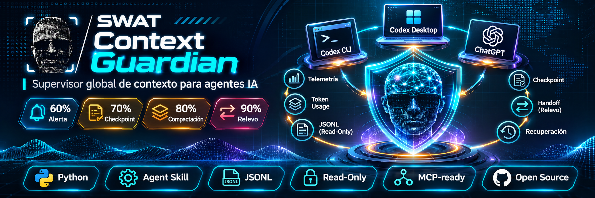
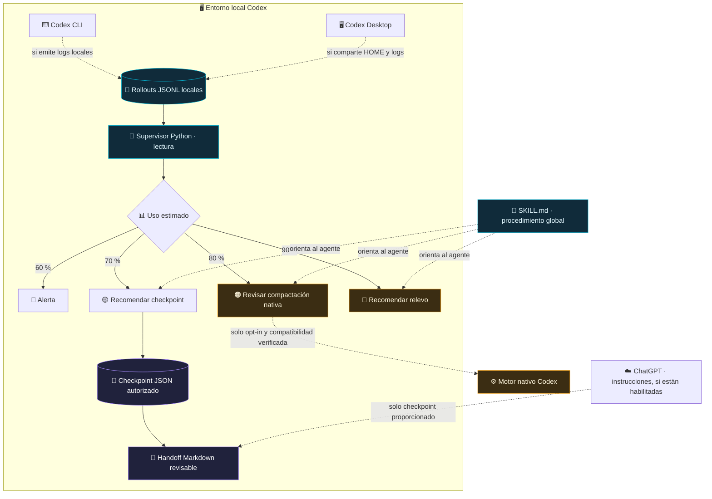
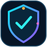

<div align="right">

🌐 **Idioma:** **🇪🇸 Español** · [🇬🇧 English](README.en.md) · [🇵🇹 Português](README.pt.md)

</div>

<div align="center">
  

  # 🛡️ SWAT Context Guardian

  **Skill global + supervisor local de contexto para Codex.**  
  *Telemetría aproximada · Checkpoints verificables · Relevos seguros entre sesiones y repositorios.*

  [](#estado-del-proyecto)
  [](https://www.python.org/)
  [](docs/INSTALAR_CODEX_CLI.md)
  [](docs/INSTALAR_CODEX_DESKTOP.md)
  [](docs/INSTALAR_CHATGPT.md)

  [](SKILL.md)
  [](docs/ARQUITECTURA.md)
  [](#privacidad-y-seguridad)
  [](docs/INSTALAR_CODEX_CLI.md)
  [](docs/INSTALAR_CODEX_CLI.md)
  [](docs/INSTALAR_CODEX_CLI.md)
  [](#requisitos)
  [](#hoja-de-ruta)
  [](#pruebas)

  **[Instalación CLI](docs/INSTALAR_CODEX_CLI.md) · [Instalación Desktop](docs/INSTALAR_CODEX_DESKTOP.md) · [ChatGPT](docs/INSTALAR_CHATGPT.md) · [Arquitectura](docs/ARQUITECTURA.md)**
</div>

---

### 🧪 v0.4 Intelligence — Rama experimental

**Nueva pantalla en `/intelligence`:** calendario de calor diario, mapa de calor 7×24 horas, tendencias diarias y semanales, rachas, gráficos por modelo/proyecto, distribución input/output/cache y riesgos de contexto. Integra de forma **opcional y bajo demanda** las cuotas de [Win-CodexBar](https://github.com/nesszer/Win-CodexBar) y los costes por agente de [ccusage](https://github.com/ccusage/ccusage). No mezcla fuentes con riesgo de doble conteo.

**Instalación Windows y limitaciones:** [Guía v0.4 Intelligence](docs/INTELLIGENCE_V04.md). Esta rama no sustituye la release estable v0.3.1; los adaptadores externos requieren sus CLI instaladas y no se ha probado aún en el Windows real del usuario.

### 🆕 v0.3.1 · Sesiones únicas, estado verificable e historial

- **Un ID de hilo = una sesión** en el panel, incluso cuando varios archivos `rollout-*.jsonl` comparten identificador. Las distintas rutas permanecen en **Ver historial**.
- El porcentaje visible utiliza **la medición válida más reciente por fecha**, no el máximo histórico. La ficha muestra la fecha de medición y la de última modificación por separado.
- **Activa verificada** solo cuando App Server está conectado y comunica estado `active` reciente. **Reciente** significa archivo modificado o evento observado en las últimas 24 horas, **sin confirmar ejecución**. Las demás son **Históricas**.
- La vista general muestra únicamente activas y recientes por defecto. En **Sesiones** hay filtros para activas, recientes, históricas y todas.
- La ficha incorpora **Ver historial**, **Copiar ruta** y **Abrir carpeta** (Windows; acción explícita y limitada a `CODEX_HOME/sessions`). No elimina ni edita JSONL.

**[Guía completa de actualización desde v0.3.0](docs/ACTUALIZAR_v0.3.1.md).**

**Actualización segura desde v0.3.0 en PowerShell:** detén el servidor antiguo con `Ctrl+C` en su terminal, descomprime esta versión en otra carpeta y ejecuta `start-control-center.ps1 -WithToasts` desde el paquete nuevo. No borres `~/.codex/sessions/` ni la base SQLite; esta actualización no sustituye automáticamente la skill global. El panel **no instala un servicio permanente**.

## 🖥️ Nuevo en v0.3: SWAT Context Guardian Control Center

     

**Panel web local en `http://127.0.0.1:8765`** para observar sesiones por proyecto, porcentaje de contexto, fuente de datos, alertas y checkpoints. La UI obtiene datos de JSONL y opcionalmente de App Server mediante WebSocket autenticado. No controla sesiones externas, no compacta ni realiza backups horarios.

```powershell
cd "$HOME\Downloads\swat-context-guardian"
.\start-control-center.ps1                   # Panel JSONL
# O bien:
.\start-control-center.ps1 -WithToasts       # Activa popup Windows
.\start-control-center.ps1 -Demo -Port 8766  # Demo claramente simulada
```

Para conectar el App Server de forma segura, utiliza las instrucciones de **[docs/CONTROL_CENTER.md](docs/CONTROL_CENTER.md)**. El monitor se ejecuta mientras su proceso esté abierto, aunque se cierre el navegador. `-WithAppServer` conecta a `ws://127.0.0.1:4500`; **no arranca Codex automáticamente**, ni se suscribe por defecto a hilos externos.

```powershell
# Después de levantar un App Server con --ws-auth capability-token
.\start-control-center.ps1 -WithAppServer -WithToasts -TokenFile "$HOME\.codex\context-guardian\ws-token.txt"
```

> **Seguridad:** solo loopback, token de acciones de la UI, lectura de sesiones, registros SQLite de metadatos, notificaciones solo tras cruce observado de umbral. La instalación global previa de la skill se conserva salvo `--replace` con backup. **La conexión real con tu versión de Codex aún debe probarse en tu equipo.**

## ✨ ¿Qué es?

**SWAT Context Guardian** resuelve un problema cotidiano de los agentes de desarrollo: las sesiones acumulan contexto, pero las **decisiones, restricciones de seguridad, verificaciones y tareas pendientes** no deben perderse cuando el contexto se compacta o el equipo cambia de conversación.

El proyecto combina **dos componentes diferentes**:

1. **🧠 Skill global (`SKILL.md`)**. Define un procedimiento repetible de diagnóstico, clasificación de evidencias, elaboración de checkpoints y handoff. Se instala en `~/.agents/skills/swat-context-guardian/` y puede usarse desde cualquier repositorio en el mismo entorno Codex.
2. **📡 Supervisor Python (`scripts/guardian.py`)**. Se ejecuta **por separado** y lee los JSONL locales de las sesiones Codex, sin modificar la conversación. Presenta una **estimación**, no la cifra exacta del motor, y emite alertas por umbrales.

> [!IMPORTANT]
> **Una skill no es un daemon.** Instalarla no ejecuta el supervisor en segundo plano, no compacta de forma automática sesiones externas y no concede a ChatGPT acceso a los archivos de tu equipo.

### 🧩 Funcionalidades e iconografía

| Icono | Módulo | Función | Estado v0.3 |
|:---:|---|---|---|
| 🧭 | **Doctor** | Verificar rutas de Codex y disponibilidad de sesiones. | ✅ Implementado |
| 📊 | **Status** | Mostrar estimación de ocupación por sesión. | ✅ Implementado |
| 📡 | **Watch** | Vigilancia continua mediante proceso local. | ✅ Implementado |
| 🧾 | **Checkpoint** | Crear JSON con datos aportados explícitamente y metadatos del proyecto. | ✅ Implementado |
| 🔁 | **Handoff** | Generar Markdown de continuidad revisable. | ✅ Implementado |
| 🛡️ | **Safety Guard** | Evitar sobrescrituras accidentales y preservar backups de configuración. | ✅ Controles básicos |
| 🧠 | **Native Compaction** | Previsualizar ajuste opcional de compactación de Codex. | ⚠️ Requiere autorización y versión compatible |
| 🔌 | **App Server WS** | Consulta metadatos y eventos disponibles en un servidor local autenticado. | ✅ Integración opcional y experimental |
| ☁️ | **ChatGPT** | Instrucciones reutilizables para revisar checkpoints suministrados. | 📄 Paquete separado; sujeto a disponibilidad |

## 🚦 Política de contexto

| Nivel aproximado | Señal | Conducta recomendada | ¿Ejecuta acciones destructivas? |
|:---:|---|---|:---:|
| 🔵 **60 %** | Alerta temprana | Reducir salidas voluminosas, vigilar. | No |
| 🟡 **70 %** | Checkpoint | Conservar decisiones y evidencias verificadas. | No |
| 🟠 **80 %** | Compactación | Revisar el mecanismo nativo **si está habilitado y es compatible**. | No |
| 🔴 **90 %** | Relevo | Preparar Markdown y validar continuidad en otra sesión. | No |

Los umbrales son **política de aviso del supervisor**, no una garantía de que Codex compactará exactamente en esos porcentajes. Si faltan métricas, se informa `SIN MEDICIÓN` en lugar de calcular cifras inventadas.

## 🏗️ Arquitectura



**Entrada de telemetría:** `last_token_usage.total_tokens` y `model_context_window` cuando aparecen en el historial local. **Salida de telemetría:** estimación y alertas JSONL propias. **Entrada de checkpoint:** únicamente texto/evidencia que el operador o el agente haya verificado y pasado explícitamente; no se extraen transcripciones automáticamente.

## 📦 Requisitos

- Python **3.11+**. El monitor CLI utiliza solo biblioteca estándar; el panel instala FastAPI, Uvicorn y websockets en un entorno virtual.
- Codex CLI o Desktop con sesiones locales accesibles para **monitorizar**. Para elaborar un checkpoint sin telemetría también puedes usar el comando manual.
- Permisos de lectura sobre `CODEX_HOME/sessions` para el monitor y de escritura en `CODEX_HOME/context-guardian` para sus propios reportes.
- El monitor CLI no requiere dependencias externas. El panel web v0.3 utiliza FastAPI/Uvicorn/websockets, instalados en `.venv`. No requiere Node.js.

## 🚀 Instalación rápida (Windows PowerShell)

1. Descarga y descomprime `SWAT-Context-Guardian-v0.3.1-Control-Center.zip`. Dentro debe existir `swat-context-guardian/`.
2. Abre PowerShell y ejecuta:

```powershell
cd "$HOME\Downloads\swat-context-guardian"
python .\scripts\install_global.py                 # Vista previa: NO modifica nada
python .\scripts\install_global.py --apply          # Instala global, sin sobrescribir
```

3. Valida que el monitor funciona:

```powershell
$g = "$HOME\.agents\skills\swat-context-guardian\scripts\guardian.py"
python $g doctor
python $g status
python $g watch --interval 10
```

4. En Codex, abre una sesión nueva, ejecuta `/skills` o invoca:

```text
$swat-context-guardian analiza la ocupación de contexto de esta sesión y prepara un checkpoint seguro sin tocar el proyecto.
```

> [!NOTE]
> Si `python` no existe pero tienes `py`, usa `py -3.11` o tu versión Python 3.11+. `watch` permanece ejecutándose **solo mientras exista el proceso**; Ctrl+C lo detiene.

### 🐧 Linux, macOS y Termux

```bash
cd ~/Downloads/swat-context-guardian
python3 scripts/install_global.py
python3 scripts/install_global.py --apply
python3 ~/.agents/skills/swat-context-guardian/scripts/guardian.py doctor
python3 ~/.agents/skills/swat-context-guardian/scripts/guardian.py status
python3 ~/.agents/skills/swat-context-guardian/scripts/guardian.py watch --interval 10
```

En **Termux**, las descargas pueden estar en `~/storage/downloads/`. Las sesiones de Windows, WSL, Termux y equipos remotos **no comparten automáticamente logs**.

### 🖥️ Codex Desktop

Para una instalación local bajo el **mismo usuario y HOME** que Codex CLI, la skill se comparte a través de `~/.agents/skills/`. Verifica que aparezca en el selector de Skills; si no, reinicia la aplicación. **El monitor debe ejecutarse desde una terminal aparte.** En sesiones remotas o entornos distintos, revisa el HOME y los permisos en ese entorno.

➡️ [Guía detallada de Codex Desktop](docs/INSTALAR_CODEX_DESKTOP.md)

### ☁️ ChatGPT

**La instalación directa depende de tu plan y espacio de trabajo.** A noviembre de 2026, la documentación de OpenAI menciona ChatGPT **Business, Enterprise, Healthcare y Edu** elegibles. En Plus no debe presumirse que la instalación de skills esté disponible.

- **Con Skills habilitadas:** abre `Plugins / Complementos` → `Skills / Habilidades` → `Crear` → `Subir desde el ordenador`. Usa el ZIP de skill **separado** `SWAT-Context-Guardian-ChatGPT-Skill.zip`, preparado como guía de continuidad **sin proceso local**.
- **Sin Skills habilitadas (por ejemplo, Plus):** crea un Proyecto de ChatGPT, copia las instrucciones de [`docs/CHATGPT_PROJECT_INSTRUCTIONS.md`](docs/CHATGPT_PROJECT_INSTRUCTIONS.md) y suministra los checkpoints cuando quieras elaborar el relevo.

> [!WARNING]
> ChatGPT no gana acceso a `~/.codex` por importar una skill. No mide el porcentaje real de contexto de este chat ni controla el motor local de Codex. Para sincronizar datos de forma activa haría falta un conector/app o MCP **desarrollado y autorizado aparte**.

➡️ [Guía detallada de ChatGPT](docs/INSTALAR_CHATGPT.md)

## 🛠️ Uso de la CLI de Guardian

Los siguientes ejemplos asumen que ya instalaste la skill global.

### 1. Diagnosticar

```powershell
$g = "$HOME\.agents\skills\swat-context-guardian\scripts\guardian.py"
python $g doctor
python $g status
python $g status --json
```

### 2. Monitorizar y registrar eventos

```powershell
python $g watch --interval 10
```

Alertas: `~/.codex/context-guardian/alerts.jsonl` (o `$CODEX_HOME/context-guardian/alerts.jsonl`). Si no hay rollouts recientes, el programa lo informa; no simula métricas.

### 3. Crear checkpoint explícito

```powershell
python $g checkpoint `
  --project "C:\Dev\SWAT\update" `
  --summary "Estado verificado del proyecto" `
  --decisions "Decisiones expresamente aprobadas" `
  --evidence "Commit, tests y evidencias contrastadas" `
  --pending "Pendientes reales" `
  --next-step "Próximo paso autorizado" `
  --safety "No tocar producción ni migraciones"
```

El comando muestra `CHECKPOINT=...`. El contenido semántico no se adivina ni se extrae del historial bruto: lo proporciona el operador/agente con respaldo comprobable.

### 4. Preparar relevo

```powershell
python $g handoff --checkpoint "RUTA_REAL_DEL_CHECKPOINT.json"
```

Revisa el Markdown antes de pasarlo a otro chat; valida que **rama, commit, pruebas, restricciones y próximos pasos** sigan siendo correctos.

### 5. Configurar compactación nativa de Codex (opcional)

```powershell
$skill = "$HOME\.agents\skills\swat-context-guardian"
python "$skill\scripts\native_compaction.py" --percent 80

# Solo con versión compatible comprobada y permiso explícito:
python "$skill\scripts\native_compaction.py" `
  --percent 80 --apply --acknowledge-compatibility
```

**El instalador normal no toca `~/.codex/config.toml`.** Este comando opcional comprueba TOML, bloquea un valor ya existente, crea backup e intenta agregar una sola configuración. No puede demostrar que Codex haya compactado y no controla ChatGPT.

## 📂 Estructura del repositorio

```text
swat-context-guardian/
├── README.md                        # Guía principal en español
├── README.en.md                     # Versión en inglés
├── README.pt.md                     # Versión en portugués
├── SKILL.md                         # Skill global para Codex
├── agents/
│   └── openai.yaml                 # Metadatos visuales de la skill
├── assets/
│   ├── banner-swat-context-guardian.png
│   ├── guardian-icon.svg
│   └── guardian-logo.png
├── docs/
│   ├── INSTALAR_CODEX_CLI.md
│   ├── INSTALAR_CODEX_DESKTOP.md
│   ├── INSTALAR_CHATGPT.md
│   ├── CHATGPT_PROJECT_INSTRUCTIONS.md
│   └── ARQUITECTURA.md
├── references/
│   ├── COMPACTACION.md
│   └── CONTINUIDAD.md
├── scripts/
│   ├── guardian.py
│   ├── native_compaction.py
│   └── install_global.py
└── tests/
    └── test_guardian.py
```

## 🔐 Privacidad y seguridad

- **Read-only respecto a rollouts:** no se reescriben logs de sesiones Codex.
- **Monitor CLI sin red:** no envía credenciales ni historiales. El panel web usa loopback y puede conectarse únicamente al App Server local con token explícito.
- **Sin cambios automáticos en Codex/producción:** jamás modifica Git, contenedores, migraciones o servicios al cruzar un umbral.
- **Sin resumen inventado:** el programa no reconstruye decisiones con IA; genera checkpoints con texto proporcionado explícitamente.
- **Aislamiento de proyectos:** los relevos deben preservar rutas, rama/HEAD, evidencias y restricciones del proyecto concreto.
- **Instalación conservadora:** vista previa por defecto, negativa a sobrescribir y backup al reemplazar bajo autorización.
- **Revisión humana:** los checkpoints pueden contener rutas o detalles sensibles escritos por quien los crea; revisa antes de compartir.

## 🧪 Pruebas

```bash
python -m unittest discover -s tests -v
```

**Validación de esta entrega:** 15 pruebas unitarias y de integración simulada, en entorno aislado. Esto **no prueba** compatibilidad con cada versión de Codex ni instalación real en tu máquina.

## 🗺️ Hoja de ruta

- [x] Skill global para Codex CLI.
- [x] Observador Python de telemetría local JSONL.
- [x] Checkpoints JSON explícitos y handoffs Markdown.
- [x] Instalador conservador y pruebas unitarias.
- [x] Metadatos y banner para README / selector de skills.
- [x] Cliente WebSocket experimental de App Server con `initialize`, `thread/list` y eventos disponibles; probado contra servidor simulado.
- [ ] Validar el puente con el binario real de Codex instalado por el usuario.
- [ ] Servicio persistente opcional de Windows/systemd con instalación y desinstalación seguras.
- [ ] API/MCP de métricas sanitizadas con autenticación y permisos, si se autoriza.
- [ ] Integración supervisada con ChatGPT mediante un conector aprobado.

## 📌 Estado del proyecto

**MVP local v0.3.1**. Los badges estáticos describen las tecnologías y el alcance del paquete; **no sustituyen pruebas de integración ni demuestran compatibilidad con una versión concreta del cliente**. La licencia de distribución debe elegirse y publicarse en un archivo `LICENSE` antes de afirmar condiciones de reutilización open source.

## 📚 Referencias oficiales

- [OpenAI — Build Skills](https://learn.chatgpt.com/docs/build-skills)
- [OpenAI — ChatGPT Skills](https://help.openai.com/es-es/articles/20001066-skills-in-chatgpt)
- [OpenAI — Codex Configuration](https://learn.chatgpt.com/docs/config-file/config-basic)
- [OpenAI — Codex source](https://github.com/openai/codex)

---

<div align="center">
  

  **SWAT Context Guardian** · *El contexto cambia; las decisiones verificadas permanecen.*
</div>
