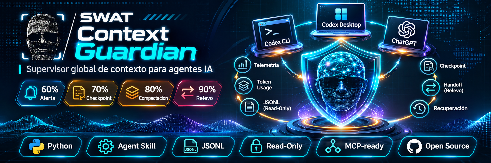
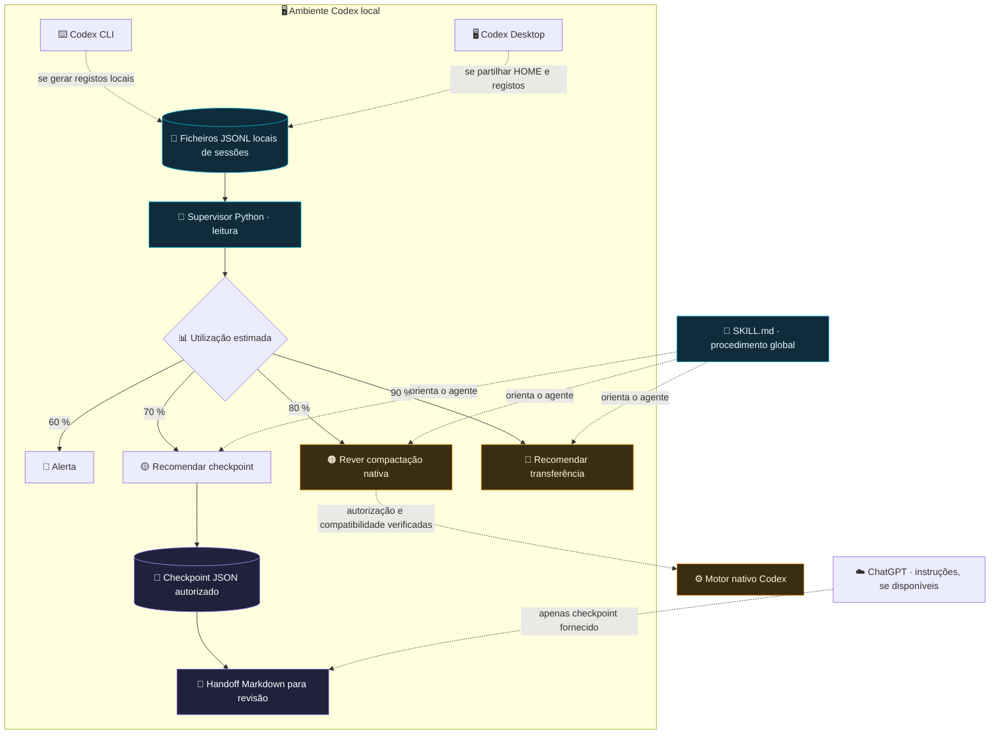

<div align="right">

🌐 **Idioma:** [🇪🇸 Español](README.md) · [🇬🇧 English](README.en.md) · **🇵🇹 Português**

</div>

<div align="center">
  

  # 🛡️ SWAT Context Guardian

  **Skill global + supervisor local de contexto para Codex.**  
  *Telemetria aproximada · Checkpoints verificáveis · Transferências seguras entre sessões e repositórios.*

  [](#estado-do-projeto)
  [](https://www.python.org/)
  [](docs/INSTALAR_CODEX_CLI.md)
  [](docs/INSTALAR_CODEX_DESKTOP.md)
  [](docs/INSTALAR_CHATGPT.md)

  [](SKILL.md)
  [](docs/ARQUITECTURA.md)
  [](#privacidade-e-segurança)
  [](docs/INSTALAR_CODEX_CLI.md)
  [](docs/INSTALAR_CODEX_CLI.md)
  [](docs/INSTALAR_CODEX_CLI.md)
  [](#requisitos)
  [](#roteiro-de-evolução)
  [](#testes)

  **[Instalação CLI](docs/INSTALAR_CODEX_CLI.md) · [Instalação Desktop](docs/INSTALAR_CODEX_DESKTOP.md) · [ChatGPT](docs/INSTALAR_CHATGPT.md) · [Arquitetura](docs/ARQUITECTURA.md)**

  <sub>Os guias detalhados associados encontram-se atualmente em espanhol; este README inclui as principais instruções de instalação e utilização em português.</sub>
</div>

---

### 🆕 v0.3.1 · Sessões únicas, estado verificado e histórico

- **Um ID de thread = uma sessão** no painel, mesmo quando vários ficheiros `rollout-*.jsonl` têm o mesmo identificador. Os caminhos continuam disponíveis em **Ver histórico**.
- A percentagem apresentada usa **a medição válida mais recente pela data**, e não a percentagem histórica mais elevada. As datas da medição e da modificação do ficheiro são distintas.
- **Ativa verificada** exige App Server ligado e um estado `active` recente. **Recente** significa ficheiro alterado ou evento observado nas últimas 24 horas e **não comprova execução**; as restantes são **Históricas**.
- A vista geral mostra apenas sessões ativas e recentes por padrão. Em **Sessões** existem filtros para ativas, recentes, históricas e todas.
- Os detalhes incluem **Ver histórico**, **Copiar caminho** e **Abrir pasta** (Windows, ação explícita limitada a `CODEX_HOME/sessions`). Os ficheiros JSONL não são alterados.

**Atualização segura da v0.3.0:** pare o servidor anterior com `Ctrl+C`, extraia a v0.3.1 para outra pasta e execute `start-control-center.ps1 -WithToasts` a partir da nova versão. Não elimine `~/.codex/sessions/` nem o histórico SQLite. Esta atualização não substitui automaticamente a skill global nem instala um serviço permanente.

## 🖥️ Novo na v0.3: SWAT Context Guardian Control Center

     

**Painel local em `http://127.0.0.1:8765`** com sessões organizadas por projeto, percentagem aproximada de contexto, origem dos dados, alertas e checkpoints apenas de metadados. A leitura JSONL funciona de forma independente; a ligação WebSocket autenticada ao Codex App Server é opcional. Não controla sessões externas, não compacta conversas e não efetua backups horários.

```powershell
cd "$HOME\Downloads\swat-context-guardian"
.\start-control-center.ps1                    # Painel JSONL
.\start-control-center.ps1 -WithToasts        # Notificações Windows
.\start-control-center.ps1 -Demo -Port 8766   # Simulação explícita
```

Para configurar o token do App Server, consulte **[o guia Control Center](docs/CONTROL_CENTER.md)** (em espanhol, com comandos PowerShell). Depois de iniciar o Codex App Server com `--ws-auth capability-token`:

```powershell
.\start-control-center.ps1 -WithAppServer -WithToasts -TokenFile "$HOME\.codex\context-guardian\ws-token.txt"
```

O monitor continua em execução enquanto o processo de backend estiver aberto, mesmo com o browser fechado. A integração WebSocket não recebe automaticamente os eventos de conversas pertencentes a outros clientes e requer validação com a sua versão do Codex.

## ✨ O que é?

O **SWAT Context Guardian** resolve um problema frequente dos agentes de desenvolvimento: as sessões acumulam contexto, mas as **decisões, restrições de segurança, verificações e tarefas pendentes** não podem perder-se durante a compactação do contexto ou a passagem para outra conversa.

O projeto reúne **dois componentes distintos**:

1. **🧠 Skill global (`SKILL.md`)**. Define um procedimento repetível para diagnóstico, classificação de evidências, criação de checkpoints e transferência de contexto. É instalada em `~/.agents/skills/swat-context-guardian/` e pode ser utilizada em vários repositórios no mesmo ambiente Codex.
2. **📡 Supervisor Python (`scripts/guardian.py`)**. É executado **separadamente** e lê os ficheiros JSONL locais das sessões Codex sem modificar a conversa. Apresenta uma **estimativa**, não a medição exata do motor, e emite alertas por limiar.

> [!IMPORTANT]
> **Uma skill não é um daemon.** Instalá-la não inicia o supervisor em segundo plano, não compacta automaticamente sessões externas nem concede ao ChatGPT acesso aos ficheiros do computador.

### 🧩 Funcionalidades e ícones

| Ícone | Módulo | Função | Estado v0.3 |
|:---:|---|---|---|
| 🧭 | **Doctor** | Verificar caminhos do Codex e disponibilidade de sessões. | ✅ Implementado |
| 📊 | **Status** | Apresentar a ocupação estimada do contexto por sessão. | ✅ Implementado |
| 📡 | **Watch** | Monitorização contínua através de um processo local. | ✅ Implementado |
| 🧾 | **Checkpoint** | Criar JSON com informação fornecida explicitamente e metadados do projeto. | ✅ Implementado |
| 🔁 | **Handoff** | Gerar Markdown de continuidade para revisão. | ✅ Implementado |
| 🛡️ | **Safety Guard** | Evitar substituições acidentais e preservar cópias de segurança da configuração. | ✅ Proteções básicas |
| 🧠 | **Native Compaction** | Pré-visualizar a configuração opcional de compactação do Codex. | ⚠️ Exige autorização e uma versão compatível |
| 🔌 | **App Server WS** | Consulta de metadados/eventos disponíveis num App Server local autenticado. | ✅ Opcional, experimental |
| ☁️ | **ChatGPT** | Instruções reutilizáveis para rever checkpoints fornecidos. | 📄 Pacote separado; sujeito à disponibilidade |

## 🚦 Política de contexto

| Nível aproximado | Sinal | Ação recomendada | Ações destrutivas? |
|:---:|---|---|:---:|
| 🔵 **60 %** | Alerta antecipado | Reduzir saídas extensas e continuar a monitorizar. | Não |
| 🟡 **70 %** | Checkpoint | Preservar decisões e evidências verificadas. | Não |
| 🟠 **80 %** | Compactação | Rever o mecanismo nativo **se estiver ativo e for compatível**. | Não |
| 🔴 **90 %** | Transferência | Preparar o Markdown e validar a continuidade noutra sessão. | Não |

Estes limiares são **alertas do supervisor**, não uma garantia de que o Codex efetuará a compactação exatamente nessas percentagens. Se faltarem métricas, a ferramenta apresenta `SIN MEDICIÓN` (sem medição), em vez de inventar valores.

## 🏗️ Arquitetura



**Entrada de telemetria:** `last_token_usage.total_tokens` e `model_context_window`, quando existirem no histórico local. **Saída de telemetria:** estimativas e alertas JSONL produzidos pelo supervisor. **Entrada do checkpoint:** apenas texto ou evidência fornecidos e verificados explicitamente pelo operador ou agente; não são extraídas transcrições automaticamente.

## 📦 Requisitos

- **Python 3.11+**, apenas com a biblioteca padrão (`tomllib`, `argparse`, `json`, etc.).
- Codex CLI ou Desktop com sessões locais acessíveis **para monitorização**. Também é possível criar manualmente um checkpoint sem telemetria.
- Permissões de leitura em `CODEX_HOME/sessions` e de escrita em `CODEX_HOME/context-guardian` para os relatórios do supervisor.
- Não são necessárias chaves de API, serviços web nem dependências obrigatórias de Node.js.

## 🚀 Instalação rápida (Windows PowerShell)

1. Transfira e extraia `SWAT-Context-Guardian-v0.3.1-Control-Center.zip`. No interior deverá existir a pasta `swat-context-guardian/`.
2. Abra o PowerShell e execute:

```powershell
cd "$HOME\Downloads\swat-context-guardian"
python .\scripts\install_global.py                 # Pré-visualização: NÃO altera nada
python .\scripts\install_global.py --apply          # Instalação global, sem substituir ficheiros
```

3. Valide o funcionamento do supervisor:

```powershell
$g = "$HOME\.agents\skills\swat-context-guardian\scripts\guardian.py"
python $g doctor
python $g status
python $g watch --interval 10
```

4. No Codex, abra uma nova sessão, utilize `/skills` ou invoque:

```text
$swat-context-guardian analisa a ocupação do contexto desta sessão e prepara um checkpoint seguro sem alterar o projeto.
```

> [!NOTE]
> Se o comando `python` não existir, mas `py` estiver disponível, utilize `py -3.11` ou a sua versão de Python 3.11+. O `watch` fica em execução **apenas enquanto o processo estiver ativo**; interrompa-o com Ctrl+C.

### 🐧 Linux, macOS e Termux

```bash
cd ~/Downloads/swat-context-guardian
python3 scripts/install_global.py
python3 scripts/install_global.py --apply
python3 ~/.agents/skills/swat-context-guardian/scripts/guardian.py doctor
python3 ~/.agents/skills/swat-context-guardian/scripts/guardian.py status
python3 ~/.agents/skills/swat-context-guardian/scripts/guardian.py watch --interval 10
```

No **Termux**, os ficheiros transferidos podem estar em `~/storage/downloads/`. As sessões de Windows, WSL, Termux e máquinas remotas **não partilham automaticamente os registos**.

### 🖥️ Codex Desktop

Quando Codex Desktop e CLI forem executados com **o mesmo utilizador e a mesma HOME**, podem partilhar a skill instalada em `~/.agents/skills/`. Verifique se aparece no seletor de Skills e, se necessário, reinicie a aplicação. **O supervisor continua a exigir um terminal separado.** Para sessões remotas ou ambientes isolados, confirme o diretório HOME e as permissões correspondentes.

➡️ [Guia detalhado do Codex Desktop (espanhol)](docs/INSTALAR_CODEX_DESKTOP.md)

### ☁️ ChatGPT

**A instalação direta depende do seu plano e espaço de trabalho.** A documentação original da v0.3 enumera espaços de trabalho elegíveis de ChatGPT **Business, Enterprise, Healthcare e Edu**. Não se deve assumir que a instalação de skills está disponível no Plus sem verificar a interface e a documentação atuais.

- **Se as Skills estiverem disponíveis:** abra `Plugins / Complementos` → `Skills / Habilidades` → `Criar` → `Carregar do computador` (os nomes podem variar). Utilize o ZIP de skill **separado** `SWAT-Context-Guardian-ChatGPT-Skill.zip`, preparado para orientar a continuidade **sem processo local**.
- **Se as Skills não estiverem disponíveis:** crie um Projeto do ChatGPT, copie as instruções de [`docs/CHATGPT_PROJECT_INSTRUCTIONS.md`](docs/CHATGPT_PROJECT_INSTRUCTIONS.md) e forneça os checkpoints quando necessitar de preparar uma transferência.

> [!WARNING]
> Importar uma skill não dá ao ChatGPT acesso a `~/.codex`. O ChatGPT não pode medir a percentagem exata de contexto desta conversa nem controlar um motor Codex local. A sincronização ativa exigiria um conector/app ou integração MCP desenvolvida e autorizada em separado.

➡️ [Guia detalhado do ChatGPT (espanhol)](docs/INSTALAR_CHATGPT.md)

## 🛠️ Utilização da CLI do Guardian

Os exemplos seguintes pressupõem que a skill global já foi instalada.

### 1. Diagnosticar

```powershell
$g = "$HOME\.agents\skills\swat-context-guardian\scripts\guardian.py"
python $g doctor
python $g status
python $g status --json
```

### 2. Monitorizar e registar eventos

```powershell
python $g watch --interval 10
```

Alertas: `~/.codex/context-guardian/alerts.jsonl` (ou `$CODEX_HOME/context-guardian/alerts.jsonl`). Se não existirem ficheiros de sessões recentes, o programa informa-o; não simula métricas.

### 3. Criar um checkpoint explícito

```powershell
python $g checkpoint `
  --project "C:\Dev\SWAT\update" `
  --summary "Estado verificado do projeto" `
  --decisions "Decisões expressamente aprovadas" `
  --evidence "Commits, testes e evidências confirmadas" `
  --pending "Questões realmente pendentes" `
  --next-step "Próximo passo autorizado" `
  --safety "Não alterar produção nem migrações"
```

O comando apresenta `CHECKPOINT=...`. O conteúdo semântico não é adivinhado nem extraído automaticamente do histórico completo: é fornecido pelo operador/agente com evidências verificáveis.

### 4. Preparar a transferência

```powershell
python $g handoff --checkpoint "CAMINHO_REAL_DO_CHECKPOINT.json"
```

Reveja o Markdown antes de o partilhar com outra conversa. Confirme que **ramo, commit, testes, restrições e próximos passos** continuam corretos.

### 5. Configurar a compactação nativa do Codex (opcional)

```powershell
$skill = "$HOME\.agents\skills\swat-context-guardian"
python "$skill\scripts\native_compaction.py" --percent 80

# Apenas após verificar a compatibilidade e obter autorização explícita:
python "$skill\scripts\native_compaction.py" `
  --percent 80 --apply --acknowledge-compatibility
```

**O instalador normal não altera `~/.codex/config.toml`.** Este comando opcional valida o TOML, recusa substituir um valor existente, cria uma cópia de segurança e tenta acrescentar uma única definição global. Não comprova que o Codex tenha efetivamente compactado uma sessão e não controla o ChatGPT.

## 📂 Estrutura do repositório

```text
swat-context-guardian/
├── README.md                        # README principal em espanhol
├── README.en.md                     # README em inglês
├── README.pt.md                     # README em português
├── SKILL.md                         # Skill global para Codex
├── agents/
│   └── openai.yaml                  # Metadados visuais da skill
├── assets/
│   ├── banner-swat-context-guardian.png
│   ├── guardian-icon.svg
│   └── guardian-logo.png
├── docs/
│   ├── INSTALAR_CODEX_CLI.md
│   ├── INSTALAR_CODEX_DESKTOP.md
│   ├── INSTALAR_CHATGPT.md
│   ├── CHATGPT_PROJECT_INSTRUCTIONS.md
│   └── ARQUITECTURA.md
├── references/
│   ├── COMPACTACION.md
│   └── CONTINUIDAD.md
├── scripts/
│   ├── guardian.py
│   ├── native_compaction.py
│   └── install_global.py
└── tests/
    └── test_guardian.py
```

## 🔐 Privacidade e segurança

- **Leitura apenas dos registos:** os ficheiros de sessões Codex nunca são reescritos.
- **Sem rede no supervisor:** não são enviadas credenciais nem históricos para serviços externos.
- **Sem alterações automáticas ao Codex/produção:** um alerta nunca modifica Git, contentores, migrações ou serviços.
- **Sem resumos inventados:** o programa não reconstrói decisões com IA; gera checkpoints a partir de texto fornecido explicitamente.
- **Separação por projeto:** as transferências devem preservar caminhos, ramo/HEAD, evidências e restrições de cada projeto.
- **Instalação conservadora:** pré-visualização por defeito, recusa de substituições não autorizadas e cópias de segurança antes de substituições aprovadas.
- **Revisão humana:** os checkpoints podem conter caminhos ou detalhes sensíveis introduzidos pelo autor; reveja-os antes de partilhar.

## 🧪 Testes

```bash
python -m unittest discover -s tests -v
```

**Validação desta entrega:** 15 testes unitários e de integração simulada num ambiente isolado, com sessões simuladas. Isto **não comprova** a compatibilidade com todas as versões do Codex nem a instalação efetiva no seu computador.

## 🗺️ Roteiro de evolução

- [x] Skill global para Codex CLI.
- [x] Monitor Python de telemetria JSONL local.
- [x] Checkpoints JSON explícitos e transferências Markdown.
- [x] Instalador conservador e testes unitários.
- [x] Metadados e banner para o README / seletor de skills.
- [x] Cliente WebSocket experimental para App Server (`initialize`, `thread/list`, notificações disponíveis), testado com servidor simulado.
- [ ] Validar a integração com o executável real de Codex do utilizador.
- [ ] Serviço persistente opcional para Windows/systemd, com instalação e remoção seguras.
- [ ] API/MCP de métricas sanitizadas com autenticação e permissões, se autorizado.
- [ ] Integração supervisionada com ChatGPT através de um conector aprovado.

## 📌 Estado do projeto

**MVP local v0.3.1.** Os badges estáticos descrevem as tecnologias e o âmbito do pacote; **não substituem testes de integração nem comprovam a compatibilidade com uma versão concreta do cliente**. É necessário escolher e publicar uma licença de distribuição num ficheiro `LICENSE` antes de afirmar condições de reutilização open source.

## 📚 Referências oficiais

- [OpenAI — Build Skills](https://learn.chatgpt.com/docs/build-skills)
- [OpenAI — ChatGPT Skills](https://help.openai.com/es-es/articles/20001066-skills-in-chatgpt)
- [OpenAI — Codex Configuration](https://learn.chatgpt.com/docs/config-file/config-basic)
- [OpenAI — Codex source](https://github.com/openai/codex)

---

<div align="center">
  

  **SWAT Context Guardian** · *O contexto muda; as decisões verificadas permanecem.*
</div>
