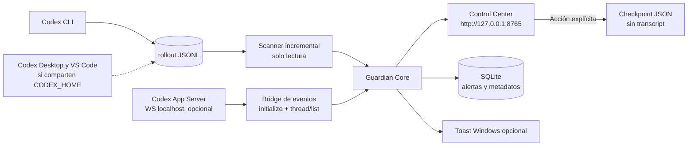

# SWAT Context Guardian Control Center v0.3.1

> **Complemento experimental v0.4:** el nuevo panel de analítica y calor está disponible en /intelligence. Consulta [INTELLIGENCE_V04.md](INTELLIGENCE_V04.md). Conserva la interfaz y semántica de este documento v0.3.1.

> **MVP local**, de lectura para las sesiones Codex. No requiere credenciales de OpenAI para leer los JSONL. La conexión con `codex app-server` es opcional y experimental. No hay compactación, backups horarios ni handoff automático.

## Vista del sistema



## Corrección v0.3.1: sesiones repetidas y actividad real

El backend consolida archivos JSONL que comparten un mismo `session_id`. El total de
**sesiones únicas** es distinto del número de **archivos de origen**. Solo aparece
una fila por hilo; la ficha **Ver historial** detalla los archivos y sus mediciones.

**Clasificación** (no confundir con procesos de Windows):

- **Activa verificada:** App Server conectado con estado `active` observado hace como máximo 60 segundos.
- **Reciente:** archivo JSONL modificado o evento recibido en las últimas 24 horas, pero sin prueba de ejecución.
- **Histórica:** fuera de la ventana de 24 horas o sin datos temporales suficientes.

En el panel, **Sesiones** incluye un filtro **Históricas**. Los archivos antiguos
solo aparecen si están incluidos en el período de descubrimiento `--hours`
(por defecto, 72 horas de *modificación de archivo*) y entre `--limit` archivos
(por defecto, 60). No implica buscar todas las sesiones históricas del disco.

Al abrir una ficha, **Copiar ruta** pone el archivo más reciente en el portapapeles.
**Abrir carpeta** solo funciona en Windows, tras clic explícito y validación de
que el archivo pertenece a `CODEX_HOME/sessions`. No abre ni ejecuta el JSONL.

La medición elegida es la de `measured_at` más reciente entre los archivos del
mismo hilo. La última modificación del archivo se muestra por separado; **no
acredita que el agente esté en ejecución**. Las estadísticas del proyecto ya
no cuentan varias veces un mismo identificador.

### Actualizar desde v0.3.0

1. En la consola de v0.3.0, presiona `Ctrl+C` para liberar el puerto 8765.
2. Extrae el ZIP v0.3.1 a otra carpeta; conserva la instalación antigua hasta validar.
3. En la nueva carpeta, ejecuta `.\start-control-center.ps1 -WithToasts`.
4. Abre `http://127.0.0.1:8765`, verifica **Sesiones únicas** y consulta **Históricas**.
5. No borres `C:\Users\MSI\.codex\sessions` ni la base de alertas.

El componente `scripts/guardian.py status` sigue mostrando snapshots por archivo;
la consolidación está implementada en el **Control Center**.

## Requisitos

- Windows 10/11, PowerShell 7 y Python 3.11 o posterior. Linux también permite utilizar el panel, aunque las notificaciones nativas de Windows no aplican.
- Una copia de este proyecto descomprimida con `start-control-center.ps1` y `control_center/`.
- Primera instalación con acceso a PyPI para FastAPI, Uvicorn y websockets; el instalador usa un entorno virtual separado (`.venv`).
- Codex CLI opcionalmente disponible, y `CODEX_HOME` en la ruta habitual `C:\Users\MSI\.codex` (o variable de entorno).
- Se usará únicamente `127.0.0.1`, sin abrir puertos al exterior.

## 1. Panel local (JSONL)

Abre PowerShell en la carpeta del ZIP descomprimido:

```powershell
cd "$HOME\Downloads\swat-context-guardian"
.\start-control-center.ps1
```

Abre **http://127.0.0.1:8765**. Podrás ver proyectos, sesiones, ocupación estimada, avisos e información de origen.

El proceso debe permanecer ejecutándose. Al detener PowerShell se detendrá el servicio. Ninguna tarea de arranque automático se instala por defecto.

### Prueba visual sin Codex

```powershell
.\start-control-center.ps1 -Demo -Port 8766
```

Abre http://127.0.0.1:8766. El panel mostrará **DEMO · SIMULADO**, no generará checkpoints ni conectará con sesiones reales.

## 2. Popups nativos de Windows

```powershell
.\start-control-center.ps1 -WithToasts
```

Instalará `winotify` si falta y habilitará las notificaciones. En el panel, utiliza **Probar notificación nativa**. Si Windows tiene las notificaciones deshabilitadas o el proceso no se ejecuta en la sesión interactiva del usuario, el aviso puede no aparecer.

**Para que los popups funcionen con el navegador cerrado, basta que el backend siga ejecutándose.** Todavía no se configura un servicio persistente ni una tarea programada.

No genera un popup por cada escaneo: solo cuando un hilo *ya observado* cruza un nuevo umbral (60, 70, 80 o 90 %). Un hilo que arranca ya al 80 % se presenta en el panel sin emitir una avalancha inicial de notificaciones.

## 3. Conexión WebSocket con autenticación (opcional)

En tu versión, `codex app-server --help` confirma `--listen` y `--ws-auth capability-token`. No recomendamos un WebSocket sin autenticación, ni siquiera para pruebas de integración.

**Primera terminal: genera token y arranca App Server.**

```powershell
$TokenDir = Join-Path $HOME '.codex\context-guardian'
New-Item -ItemType Directory -Force -Path $TokenDir | Out-Null
$TokenFile = Join-Path $TokenDir 'ws-token.txt'
if (-not (Test-Path -LiteralPath $TokenFile)) {
    $Random = [Security.Cryptography.RandomNumberGenerator]::GetBytes(48)
    $Token = [Convert]::ToBase64String($Random)
    [IO.File]::WriteAllText($TokenFile, $Token, [Text.UTF8Encoding]::new($false))
}
codex app-server --listen ws://127.0.0.1:4500 `
  --ws-auth capability-token `
  --ws-token-file $TokenFile
```

**Segunda terminal: inicia el panel con el mismo token.**

```powershell
cd "$HOME\Downloads\swat-context-guardian"
$TokenFile = Join-Path $HOME '.codex\context-guardian\ws-token.txt'
.\start-control-center.ps1 -WithAppServer -WithToasts -TokenFile $TokenFile
```

## 4. Lectura de cuenta y cuota mediante Codex App Server (en integración)

El Control Center incorpora una primera lectura bajo demanda mediante el proceso
local `codex app-server` por `stdin/stdout`. Codex conserva la autenticación y el
acceso al backend; Guardian no lee `auth.json`, no almacena respuestas crudas y
solo consulta:

- `account/read`
- `account/rateLimits/read`
- `account/usage/read`

Con el panel en marcha, la API local es:

```powershell
Invoke-RestMethod http://127.0.0.1:8765/api/codex/account
```

Si el ejecutable no está en `PATH`, inicia el panel con una ruta explícita:

```powershell
.\start-control-center.ps1 -CodexCommand 'C:\ruta\a\codex.exe'
```

Esta primera integración es deliberadamente de solo lectura y todavía no
conecta estos datos con las tarjetas visuales ni consume créditos/reset credits.
Un error del CLI devuelve `503` sin convertirlo en una medición válida.

Abre http://127.0.0.1:8765. La pestaña **Conexión Codex** mostrará el estado del enlace. El token nunca se envía al navegador ni se almacena en SQLite.

**Comprobación de puerto:**

```powershell
Invoke-WebRequest http://127.0.0.1:4500/readyz
```

Se espera `StatusCode: 200` cuando está listo. Si el puerto está ocupado, identifica primero el proceso, no lo finalices a ciegas.

**Limitación real:** una conexión nueva no recibe por defecto todos los eventos de las sesiones de Codex Desktop o de otra CLI. `thread/list` muestra metadatos almacenados y `thread/tokenUsage/updated` se usa solamente cuando el servidor lo emite a la conexión. Las sesiones externas continúan supervisándose por JSONL, si están disponibles en el mismo CODEX_HOME. Guardian no ejecuta `thread/resume`, `turn/start` ni compactación por su cuenta.

## 4. Qué almacena

| Archivo | Contenido | Frecuencia |
|---|---|---|
| `~/.codex/context-guardian/control-center.sqlite3` | Alertas: sesión, proyecto, porcentaje, fecha, fuente | Cuando cruza un umbral observado |
| `~/.codex/context-guardian/checkpoints/*.json` | Identificador de sesión, estado Git, campos vacíos para decisiones | Solo con clic explícito |
| `~/.codex/sessions/…/rollout-*.jsonl` | Archivos originales de Codex | **Guardian no los escribe** |

**No incluye** transcripciones, tokens de autenticación, backups horarios, copias de código ni resúmenes semánticos automáticos. El checkpoint de metadatos debe completarse con la skill y verificarse antes de generar un documento de relevo.

## 5. API local

- `GET /api/health`: comprobación de disponibilidad.
- `GET /api/status`: resumen de sesiones y orígenes; entrega token local para acciones explícitas en la UI.
- `GET /api/alerts`: histórico almacenado en SQLite.
- `GET /api/checkpoints`: índice de checkpoints.
- `POST /api/checkpoints`: crea checkpoint **solo** para sesión observada y con token de la UI.
- `POST /api/sessions/open-folder`: abre carpeta de un archivo observado en Windows, con token local y validación de ruta.
- `POST /api/notifications/test`: popup de prueba, si está habilitado.

La interfaz aplica defensa de `Host`, `Origin` y un token de acción exclusivo del proceso; se escucha solo en loopback. Ningún endpoint acepta comandos arbitrarios o contenido de conversaciones.

## 6. Pruebas y diagnóstico

```powershell
.\.venv\Scripts\python.exe -m unittest discover -s tests -v
.\.venv\Scripts\python.exe .\scripts\guardian.py doctor
Invoke-RestMethod http://127.0.0.1:8765/api/health
```

La prueba de WebSocket del paquete utiliza **un servidor simulado local**, no credenciales reales. Un test unitario no garantiza la compatibilidad con la versión exacta de tu binario `codex`.

## 7. Actualizar la skill global sin perder la anterior

Antes, revisa `~/.agents/skills/swat-context-guardian`. El instalador no sobrescribe nada por defecto:

```powershell
python .\scripts\install_global.py
python .\scripts\install_global.py --apply --replace
```

`--replace` renombra la skill antigua con un sufijo `backup-*` antes de instalar. No modifica `~/.codex/config.toml`, scripts del repositorio, git ni procesos externos.

## Roadmap verificado vs pendiente

- **v0.3 disponible:** panel, filtros, detalle de sesiones, fuentes JSONL, WebSocket opcional, popups Windows opt-in, SQLite, checkpoints manuales de metadatos.
- **Pendiente:** icono de bandeja residente, inicio automático con Windows, autorreconexión con permisos finos por workspace, backup incremental con cifrado, panel remoto autenticado y compactación autorizada mediante la instancia propietaria de App Server.

### Referencias técnicas

- https://developers.openai.com/codex/app-server/ — protocolos, `initialize`, `thread/list`, notificaciones y transporte WebSocket.
- https://pypi.org/project/winotify/ — biblioteca opcional de notificaciones nativas de Windows.
